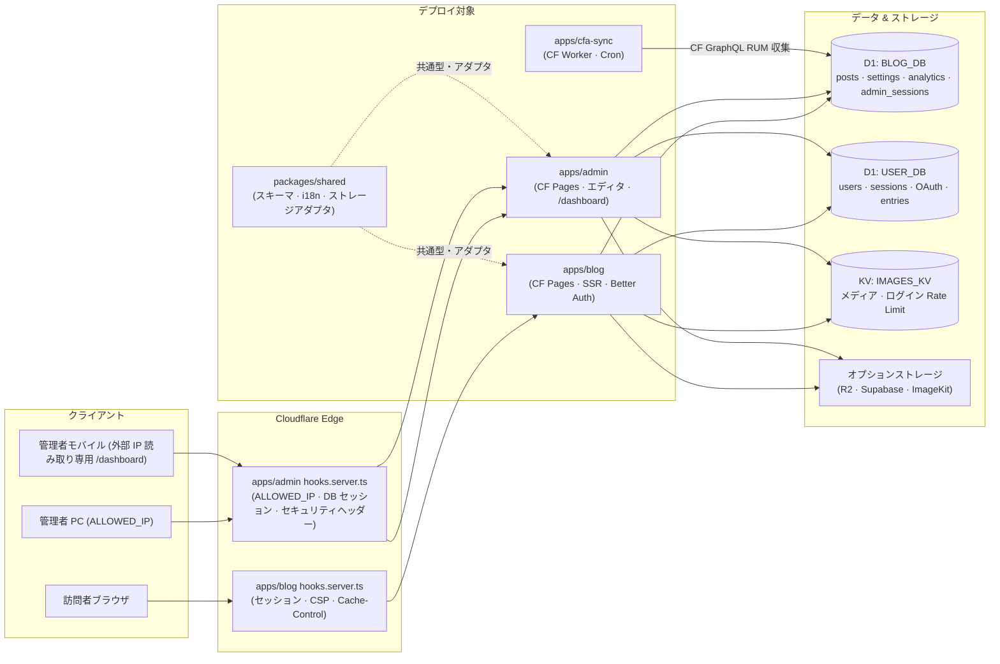

# SvelteKit Blog Engine (SKBE)

🌐 **[English](./README.md) | [한국어](./README.kr.md)**

**SKBE**は、**SvelteKit 5** と **Cloudflare のサーバーレススタック（Pages、Workers、D1、KV）** 上に構築された、セルフホスト型のオープンソースブログエンジンです。

公開ブログ、管理コンソール、アナリティクス同期ワーカーをそれぞれ独立した Cloudflare デプロイ単位として分離し、自身の D1 データベースと KV／オブジェクトストレージ上で動作するように設計されています。

- **ライブ参照デプロイ**: [sveltekitblog.com](https://sveltekitblog.com)
- **ライセンス**: [AGPL-3.0](./LICENSE)

[](https://www.youtube.com/watch?v=XOza3hgiNQw)

---

## アーキテクチャ概要

SKBE は 3つのデプロイ対象（`apps/*`）と 1つの共通コアパッケージ（`packages/shared`）で構成される npm workspace モノレポです。



### ワークスペース構成

| パス | 役割 | デプロイ先 |
| :--- | :--- | :--- |
| `apps/blog` | 公開 SSR ブログ、多言語ルーティング（`[[lang=lang]]`）、Better Auth エンドポイント、コメント／ゲストブック、RSS／サイトマップ | Cloudflare Pages |
| `apps/admin` | 管理 CMS（TipTap エディタ、マルチスロットデザインエディタ、バックアップ／復元、メディア管理、モバイル読み取り専用 `/dashboard`） | Cloudflare Pages |
| `apps/cfa-sync` | Cloudflare Web Analytics（RUM）の日次スナップショットを `BLOG_DB` に保存する定期実行ワーカー | Cloudflare Worker |
| `packages/shared` | Drizzle ORM スキーマ、D1 SQL マイグレーション、i18n 辞書、ストレージアダプタ（KV／R2／Supabase／ImageKit） | ワークスペースパッケージ（`@blog/shared`） |
| `scripts/` | リソースプロビジョニング、シークレット同期、マルチアカウントデプロイ用 CLI ツール | ローカル Node.js |

---

## 主な設計方針

### 1. 公開ブログと管理画面の分離デプロイ
`apps/blog` と `apps/admin` は個別の Cloudflare Pages プロジェクトとしてビルド・デプロイされます。
- **管理アクセス境界**: フル CMS 操作には `ALLOWED_IP` の一致と D1 `admin_sessions` によるセッション検証の両方が必要で、Cloudflare KV ベースのログイン試行回数制限が適用されます。
- **外部モバイルダッシュボード**: ホワイトリスト外の IP からのアクセスは読み取り専用の `/dashboard` に制限され、`dashboard_password_hash`（PBKDF2）と Cloudflare KV ベースのレートリミットで個別に認証します。

### 2. 用途別の D1 データベース分離（`BLOG_DB` / `USER_DB`）
- `BLOG_DB`: 記事、カテゴリ、デザインスロット、各種設定、アナリティクススナップショット、管理者セッションを保持します。
- `USER_DB`: Better Auth による訪問者認証テーブル（`user`, `session`, `account`, `verification`）および訪問者インタラクション（`entries`, `likes`）を分離して管理します。

### 3. 再ビルド不要のランタイムデザインスロット
デザイン設定（`theme`, `header`, `footer`, `layout`, `widgets`, カスタム CSS）は `BLOG_DB`（`blog_settings.design_slots`）に最大 3つの独立したスロットとして保存されます。`apps/admin` での保存内容は再ビルドや再デプロイなしで `apps/blog` に即時反映され、スロット単位での JSON エクスポート／インポートにも対応しています。

### 4. 切り替え可能なメディアストレージ
デフォルトではアップロードされたメディアを `IMAGES_KV`（`/images/[...path]`）から配信し、`X-Content-Type-Options: nosniff` および SVG 向けサンドボックス CSP を付与します。必要に応じて `packages/shared` に組み込まれた **Cloudflare R2**、**Supabase Storage**、**ImageKit** アダプタへ切り替え可能です。

### 5. バックアップ・復元とステージング検証
管理コンソールからデータベースの内容と設定をアーカイブとしてエクスポート・復元できるため、別の検証環境に本番データを復元して新バージョンをテストした後に本番環境へ反映できます。

### 6. No-Surprise-Bills コストモデル
Cloudflare Free Tier ではクレジットカードを登録せずに Pages、Workers、D1、KV をプロビジョニングできます。Free Tier の上限内であれば個人ブログの**継続サーバー費用は $0** で動作し、更新を止めて放置した場合や一時的なトラフィック増加でも予期せぬ超過請求が発生しません。（独自ドメイン費用は別途必要であり、Free Tier の上限を超える規模になった場合のみ明示的に有料プランへ移行する形をとれます。）

---

## 技術スタック

- **フレームワーク**: SvelteKit 2 / Svelte 5、TypeScript、Tailwind CSS v4（Admin）
- **ランタイム & ホスティング**: Cloudflare Pages、Cloudflare Workers
- **データベース & ORM**: Cloudflare D1（SQLite）、Drizzle ORM
- **ストレージ**: Cloudflare KV（デフォルト）、R2 / Supabase / ImageKit（オプション）
- **認証**: Better Auth（ソーシャル OAuth および Web Crypto PBKDF2 によるメール／パスワード）
- **エディタ & 可視化**: TipTap v3、Marked、Chart.js

---

## はじめに

### 前提条件
- Node.js（v20 以上推奨）
- Cloudflare アカウント（個人規模であれば Free Tier で動作します）

### 1. インストールと認証
```bash
git clone https://github.com/SvelteKit-Blog-Engine/SKBE.git
cd SKBE
npm install
npm run login
```

### 2. Cloudflare リソースのプロビジョニング
自動セットアップスクリプトを実行して D1 データベース、KV ネームスペース、初期デプロイ設定を作成します：
```bash
npm run setup
```
既存リソースの選択やプロジェクト名の指定を行う場合：
```bash
npm run setup:select
```

### 3. 環境変数の設定
サンプルファイルをコピーして認証情報（`ADMIN_PASSWORD`, `BETTER_AUTH_SECRET`, `ALLOWED_IP`, OAuth キーなど）を入力します：
```text
apps/blog/.dev.vars.example  -> apps/blog/.dev.vars
apps/admin/.dev.vars.example -> apps/admin/.dev.vars
```

### 4. デプロイ
```bash
npm run deploy:main   # メインアカウント一括デプロイ (blog + admin + cfa-sync)
# または個別デプロイ:
npm run deploy:blog
npm run deploy:admin
```
`deploy:blog` と `deploy:admin` は `scripts/sync-secrets.js` でシークレットを同期したうえで SvelteKit アプリをビルドし、Cloudflare Pages にデプロイします（`deploy:admin` は未作成の場合 `apps/cfa-sync` もデプロイします。既存ワーカーを強制更新する場合は `node scripts/deploy-cfa-sync.js main --force` を実行してください）。

---

## 主なスクリプト

| コマンド | 説明 |
| :--- | :--- |
| `npm run migrate:blog-db` | リモートの `BLOG_DB` に `packages/shared/migrations/schema-blog-db.sql` を適用 |
| `npm run restore` | 復元モードでセットアップスクリプトを実行 |
| `npm run deploy:main` | デフォルト（メイン）アカウント一括デプロイ（`deploy:blog` + `deploy:admin`） |
| `npm run deploy:cfa-sync` | `apps/cfa-sync` アナリティクス Cron ワーカーをデプロイ |
| `npm run deploy:multi` | 設定された複数の Cloudflare アカウントへ一括デプロイ |
| `npm run deploy:sync` | `scripts/sync-accounts.js` によるアカウント設定同期 |

---

## 不具合報告・ライセンス

- **バグ報告 / セキュリティ問題**: GitHub Issues よりお知らせください。
- **ライセンス**: [GNU Affero General Public License v3.0 (AGPL-3.0)](./LICENSE) の下で配布されています。
- **サポート**: [Buy Me a Coffee](https://buymeacoffee.com/sveltekitblogengine)
