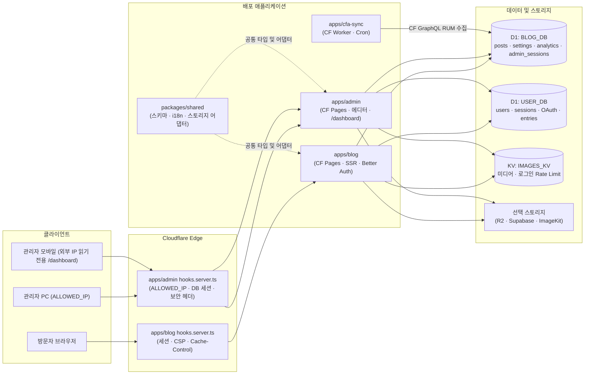

# SvelteKit Blog Engine (SKBE)

🌐 **[English](./README.md) | [日本語](./README.ja.md)**

**SKBE**는 **SvelteKit 5**와 **Cloudflare 서버리스 스택(Pages, Workers, D1, KV)** 기반으로 구축된 오픈소스 셀프호스팅 블로그 엔진입니다.

공개 블로그, 관리자 콘솔, 통계 수집 워커를 각각 독립된 Cloudflare 배포 단위로 분리하고, 사용자 본인의 D1 데이터베이스와 KV/오브젝트 스토리지 위에서 동작하도록 설계되어 있습니다.

- **라이브 레퍼런스**: [sveltekitblog.com](https://sveltekitblog.com)
- **라이선스**: [AGPL-3.0](./LICENSE)

[](https://www.youtube.com/watch?v=XOza3hgiNQw)

---

## 아키텍처 개요

SKBE는 3개의 배포 대상(`apps/*`)과 1개의 공통 코어 패키지(`packages/shared`)로 구성된 npm 워크스페이스 모노레포입니다.



### 워크스페이스 구성

| 경로 | 역할 | 배포 대상 |
| :--- | :--- | :--- |
| `apps/blog` | 공개 SSR 블로그, 다국어 라우팅(`[[lang=lang]]`), Better Auth 인증 엔드포인트, 댓글/방명록, RSS/Sitemap | Cloudflare Pages |
| `apps/admin` | 관리자 CMS (TipTap 에디터, 멀티 슬롯 디자인 에디터, 백업/복원, 미디어 관리, 모바일 읽기 전용 `/dashboard`) | Cloudflare Pages |
| `apps/cfa-sync` | Cloudflare Web Analytics(RUM) 일별 스냅샷을 `BLOG_DB`에 적재하는 스케줄 워커 | Cloudflare Worker |
| `packages/shared` | Drizzle ORM 스키마, D1 SQL 마이그레이션, i18n 사전, 스토리지 어댑터(KV/R2/Supabase/ImageKit) | 워크스페이스 패키지 (`@blog/shared`) |
| `scripts/` | 리소스 프로비저닝, 시크릿 동기화, 멀티 계정 배포 CLI 스크립트 | 로컬 Node.js |

---

## 핵심 설계 구조

### 1. 공개 블로그와 관리자 영역의 물리적 분리
`apps/blog`와 `apps/admin`은 별도의 Cloudflare Pages 프로젝트로 빌드·배포됩니다.
- **관리자 접근 경계**: 전체 CMS 기능은 `ALLOWED_IP` 일치와 D1 `admin_sessions` 세션 검증을 모두 통과해야 하며, Cloudflare KV 기반 로그인 시도 횟수 제한이 적용됩니다.
- **외부 모바일 대시보드**: 화이트리스트 외 IP에서 접근하면 읽기 전용 `/dashboard` 경로로만 제한되며, `dashboard_password_hash`(PBKDF2)와 Cloudflare KV 기반 로그인 시도 횟수 제한으로 별도 인증합니다.

### 2. 목적별 D1 데이터베이스 분리 (`BLOG_DB` / `USER_DB`)
- `BLOG_DB`: 게시글, 카테고리, 디자인 슬롯, 설정, 통계 스냅샷, 관리자 세션을 저장합니다.
- `USER_DB`: Better Auth 기반 방문자 인증 테이블(`user`, `session`, `account`, `verification`)과 방문자 상호작용(`entries`, `likes`)을 분리 관리합니다.

### 3. 재빌드 없는 런타임 디자인 슬롯
디자인 설정(`theme`, `header`, `footer`, `layout`, `widgets`, 커스텀 CSS)은 `BLOG_DB`(`blog_settings.design_slots`)에 최대 3개의 독립 슬롯으로 저장됩니다. `apps/admin`에서 저장한 변경 사항은 재빌드나 재배포 없이 `apps/blog`에 즉시 반영되며, 슬롯 단위 JSON 내보내기/가져오기를 지원합니다.

### 4. 선택 가능한 미디어 스토리지 어댑터
기본 설정에서는 업로드된 미디어를 `IMAGES_KV`(`/images/[...path]`)로 서빙하며, `X-Content-Type-Options: nosniff` 및 SVG 샌드박스 CSP를 적용합니다. 필요에 따라 `packages/shared`에 내장된 **Cloudflare R2**, **Supabase Storage**, **ImageKit** 어댑터로 전환할 수 있습니다.

### 5. 백업·복원 및 스테이징 검증
관리자 콘솔에서 DB 콘텐츠와 설정을 아카이브로 내보내고 복원할 수 있어, 별도의 테스트 배포 환경에 운영 데이터를 복원한 뒤 새 버전을 검증하고 프로덕션에 반영할 수 있습니다.

### 6. No-Surprise-Bills 비용 모델
Cloudflare Free Tier는 신용카드를 등록하지 않고도 Pages, Workers, D1, KV를 프로비저닝할 수 있습니다. Free Tier 할당량 범위 내의 개인 블로그는 **월 서버 유지비 $0**로 동작하며, 블로그를 장기간 방치하거나 트래픽이 일시적으로 몰려도 예상치 못한 초과 과금이 발생하지 않습니다. (도메인 비용은 별도이며, Free Tier 한도를 초과할 정도로 성장한 경우에만 사용자가 직접 유료 플랜 전환을 선택할 수 있습니다.)

---

## 기술 스택

- **프레임워크**: SvelteKit 2 / Svelte 5, TypeScript, Tailwind CSS v4 (Admin)
- **런타임 & 호스팅**: Cloudflare Pages, Cloudflare Workers
- **데이터베이스 & ORM**: Cloudflare D1 (SQLite), Drizzle ORM
- **스토리지**: Cloudflare KV (기본), R2 / Supabase / ImageKit (선택)
- **인증**: Better Auth (소셜 OAuth 및 Web Crypto PBKDF2 기반 이메일/비밀번호)
- **에디터 & 시각화**: TipTap v3, Marked, Chart.js

---

## 시작하기

### 사전 요구사항
- Node.js (v20 이상 권장)
- Cloudflare 계정 (개인 블로그 규모에서는 Free Tier로 충분합니다)

### 1. 설치 및 Cloudflare 로그인
```bash
git clone https://github.com/SvelteKit-Blog-Engine/SKBE.git
cd SKBE
npm install
npm run login
```

### 2. Cloudflare 리소스 프로비저닝
자동 설정 스크립트를 실행해 D1 데이터베이스, KV 네임스페이스, 초기 배포 설정을 생성합니다:
```bash
npm run setup
```
기존 리소스 선택이나 프로젝트명 직접 지정이 필요한 경우:
```bash
npm run setup:select
```

### 3. 환경 변수 설정
예제 파일을 복사해 인증 정보(`ADMIN_PASSWORD`, `BETTER_AUTH_SECRET`, `ALLOWED_IP`, OAuth 키 등)를 입력합니다:
```text
apps/blog/.dev.vars.example  -> apps/blog/.dev.vars
apps/admin/.dev.vars.example -> apps/admin/.dev.vars
```

### 4. 배포
```bash
npm run deploy:blog
npm run deploy:admin
```
`deploy:blog`와 `deploy:admin`은 `scripts/sync-secrets.js`로 시크릿을 동기화한 뒤 SvelteKit 앱을 빌드하여 Cloudflare Pages에 배포합니다 (`deploy:admin`은 `apps/cfa-sync` 워커가 없을 경우 함께 배포하며, 기존 워커 강제 업데이트 시 `node scripts/deploy-cfa-sync.js main --force`를 사용합니다).

---

## 주요 스크립트

| 명령어 | 설명 |
| :--- | :--- |
| `npm run migrate:blog-db` | 원격 `BLOG_DB`에 `packages/shared/migrations/schema-blog-db.sql` 적용 |
| `npm run restore` | 복원 모드로 설정 스크립트 실행 |
| `npm run deploy:cfa-sync` | `apps/cfa-sync` 통계 수집 Cron 워커 배포 |
| `npm run deploy:multi` | 설정된 다중 Cloudflare 계정 일괄 배포 |
| `npm run deploy:sync` | `scripts/sync-accounts.js`를 통한 계정 설정 동기화 |

---

## 이슈 및 라이선스

- **버그 제보 / 보안 이슈**: GitHub Issues를 통해 등록해 주세요.
- **라이선스**: [GNU Affero General Public License v3.0 (AGPL-3.0)](./LICENSE) 라이선스로 배포됩니다.
- **후원**: [Buy Me a Coffee](https://buymeacoffee.com/sveltekitblogengine)
