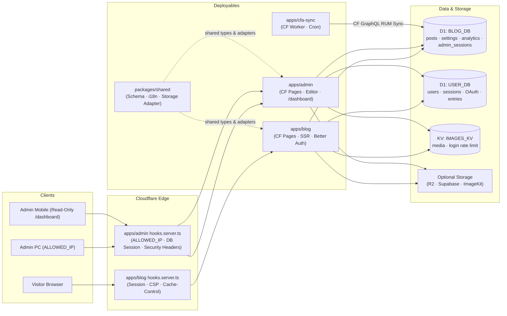

# SvelteKit Blog Engine (SKBE)

🌐 **[한국어](./README.kr.md) | [日本語](./README.ja.md)**

**SKBE** is a self-hosted, open-source blog engine built on **SvelteKit 5** and **Cloudflare's serverless stack (Pages, Workers, D1, KV)**.

It separates the public blog, the administration console, and analytics synchronization into isolated Cloudflare deployments backed by your own D1 databases and KV/object storage.

- **Live Reference Deployment**: [sveltekitblog.com](https://sveltekitblog.com)
- **Interactive Demo (Admin + Blog, Browser-Only)**: [demo.sveltekitblog.com](https://demo.sveltekitblog.com) — Designs, posts, and media backed up in the demo can be restored directly into a self-hosted SKBE instance.
- **License**: [AGPL-3.0](./LICENSE)

[](https://www.youtube.com/watch?v=XOza3hgiNQw)

---

## Architecture Overview

SKBE is structured as an npm workspace monorepo (`apps/*`, `packages/*`) with three deployable targets and one shared core package.



### Workspace Layout

| Path | Role | Deployment Target |
| :--- | :--- | :--- |
| `apps/blog` | Public SSR blog, multi-language routing (`[[lang=lang]]`), Better Auth endpoints, comments/guestbook, RSS/Sitemap | Cloudflare Pages |
| `apps/admin` | Admin CMS (TipTap editor, multi-slot design editor, backup/restore, media manager, mobile read-only `/dashboard`) | Cloudflare Pages |
| `apps/cfa-sync` | Scheduled Cloudflare Web Analytics (RUM) collector writing daily snapshots to `BLOG_DB` | Cloudflare Worker |
| `packages/shared` | Drizzle ORM schemas, D1 SQL migrations, i18n dictionaries, storage adapters (KV/R2/Supabase/ImageKit) | Workspace package (`@blog/shared`) |
| `scripts/` | Automated provisioning, secret sync, and multi-account deployment CLI tools | Local Node.js |

---

## Core Design Decisions

### 1. Separated Public & Admin Planes
`apps/blog` and `apps/admin` are built and deployed as separate Cloudflare Pages projects.
- **Admin access boundary**: Full CMS operations require both an IP match (`ALLOWED_IP`) and a valid D1-backed session (`admin_sessions`) with Cloudflare KV-based login rate limiting.
- **External mobile dashboard**: Requests from non-whitelisted IPs are restricted to `/dashboard` in read-only mode, authenticated separately via `dashboard_password_hash` (PBKDF2) and Cloudflare KV rate limiting.

### 2. Dual D1 Databases (`BLOG_DB` vs `USER_DB`)
- `BLOG_DB` stores posts, categories, design slots, settings, analytics snapshots, and admin sessions.
- `USER_DB` isolates visitor authentication tables (`user`, `session`, `account`, `verification` via Better Auth) and visitor interactions (`entries`, `likes`).

### 3. Runtime Design Slots Without Rebuild
Design configurations (`theme`, `header`, `footer`, `layout`, `widgets`, custom CSS) are stored in `BLOG_DB` (`blog_settings.design_slots`) as up to 3 independent slots. Changes saved in `apps/admin` take effect on `apps/blog` immediately without rebuilding or redeploying, and slots can be exported/imported as JSON.

### 4. Pluggable Media Storage
By default, uploaded media is served via `IMAGES_KV` (`/images/[...path]`) with `X-Content-Type-Options: nosniff` and sandboxed CSP for SVG files. External adapters for **Cloudflare R2**, **Supabase Storage**, and **ImageKit** are built into `packages/shared`.

### 5. Backup, Restore & Multi-Account Sync
The admin panel exports and restores database content and settings as portable archives, allowing you to mirror production data into a staging deployment before applying updates.

### 6. No-Surprise-Bills Cost Model
Cloudflare's Free Tier allows provisioning Pages, Workers, D1, and KV without attaching a credit card. Within Cloudflare's Free Tier limits, personal blogs run with **$0 ongoing server cost** and cannot trigger unexpected overage bills if left idle or during traffic spikes. (You still bring your own domain, and Cloudflare's Free Tier limits apply; you can explicitly upgrade only if your usage outgrows them.)

---

## Tech Stack

- **Framework**: SvelteKit 2 / Svelte 5, TypeScript, Tailwind CSS v4 (Admin)
- **Runtime & Hosting**: Cloudflare Pages, Cloudflare Workers
- **Database & ORM**: Cloudflare D1 (SQLite), Drizzle ORM
- **Storage**: Cloudflare KV (default), R2 / Supabase / ImageKit (optional)
- **Authentication**: Better Auth (OAuth & Email/Password with Web Crypto PBKDF2)
- **Editor & Visualization**: TipTap v3, Marked, Chart.js

---

## Getting Started

### Prerequisites
- Node.js (v20+ recommended)
- A Cloudflare account (Free Tier is sufficient for personal-scale usage within Cloudflare's limits)

### 1. Install & Authenticate
```bash
git clone https://github.com/SvelteKit-Blog-Engine/SKBE.git
cd SKBE
npm install
npm run login
```

### 2. Provision Cloudflare Resources
Run the automated setup script to create D1 databases, KV namespaces, and initial deployment configs:
```bash
npm run setup
```
For interactive selection (existing resources or custom project names):
```bash
npm run setup:select
```

### 3. Configure Environment Variables
Copy the example files and fill in your credentials (`ADMIN_PASSWORD`, `BETTER_AUTH_SECRET`, `ALLOWED_IP`, OAuth keys, etc.):
```text
apps/blog/.dev.vars.example  -> apps/blog/.dev.vars
apps/admin/.dev.vars.example -> apps/admin/.dev.vars
```

### 4. Deploy
```bash
npm run deploy:main   # Deploy blog + admin (+ cfa-sync if missing) in one step
# Or deploy individually:
npm run deploy:blog
npm run deploy:admin
```
`deploy:blog` and `deploy:admin` synchronize secrets via `scripts/sync-secrets.js`, build the SvelteKit apps, and deploy to Cloudflare Pages (`deploy:admin` also deploys `apps/cfa-sync` if not yet present; use `node scripts/deploy-cfa-sync.js main --force` to force-update the worker).

---

## Useful Scripts

| Command | Description |
| :--- | :--- |
| `npm run migrate:blog-db` | Apply `packages/shared/migrations/schema-blog-db.sql` to remote `BLOG_DB` |
| `npm run restore` | Run setup script in restore mode |
| `npm run deploy:main` | Deploy default account (`deploy:blog` + `deploy:admin`) in one command |
| `npm run deploy:cfa-sync` | Deploy the `apps/cfa-sync` analytics Cron Worker |
| `npm run deploy:multi` | Deploy across multiple configured Cloudflare accounts |
| `npm run deploy:sync` | Sync account configurations via `scripts/sync-accounts.js` |

---

## Issues & License

- **Bug Reports / Security Issues**: Please open an issue on GitHub.
- **License**: Distributed under the [GNU Affero General Public License v3.0 (AGPL-3.0)](./LICENSE).
- **Support**: [Buy Me a Coffee](https://buymeacoffee.com/sveltekitblogengine)
